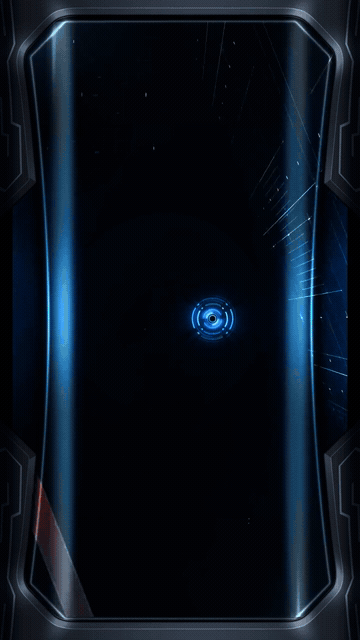
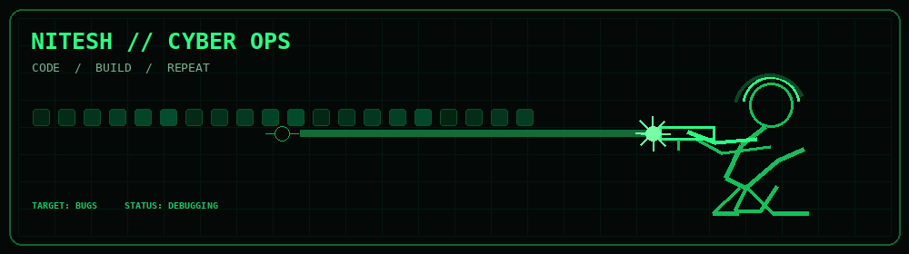

<p align="center">
  
</p>
  

  <p>
    🎓 BSc Artificial Intelligence & Data Science Student<br>
    💻 Exploring software development, AI and data<br>
    🚀 Learning by building real projects
  </p>
</div>

---

<h2 align="center">⌨️ &nbsp; SYSTEM.IDENTITY</h2>

```text
╔══════════════════════════════════════════╗
║  USER       : NITESH-DEV                 ║
║  STATUS     : LEARNING & BUILDING        ║
║  INTERESTS  : AI / CODE / TECHNOLOGY     ║
║  PHILOSOPHY : BUILD. LEARN. REPEAT.      ║
╚══════════════════════════════════════════╝
```

<h2 align="center">🟢 &nbsp; TECH ARSENAL</h2>

<div align="center">
  
</div>

<p align="center"><i>My learning toolkit — experience and proficiency vary by technology.</i></p>

<h2 align="center">📡 &nbsp; GITHUB TELEMETRY</h2>

<div align="center">
  
  
</div>

<h2 align="center">📈 &nbsp; CONTRIBUTION MATRIX</h2>

<div align="center">
  
</div>

<h2 align="center">🌐
## 🎯 CYBERPUNK MODE

<div align="center">
  
</div>
